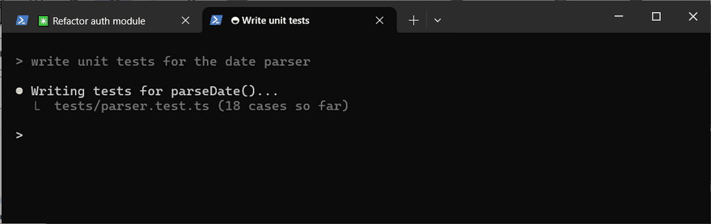

# tab-notify

Claude Code plugin for **Windows**: a soft chime when Claude finishes **or needs your input** (permission prompt, question), and your terminal (tab) comes to you — but only if you haven't already seen it.



*You're typing in a tab where Claude is still working. Another session finishes: its tab gets a 🔔 and a blinking ring. You press Enter, and it switches you over.*

## What it does

Finishing a turn and needing your input (a permission prompt, a question, an MCP input dialog) are handled exactly the same way:

| When Claude finishes / needs input and… | What happens |
|---|---|
| You're in that session's tab and were active in the last 60 s | Nothing — you've seen it |
| You're in that tab but idle (AFK) | Waits up to 3 min: any input in that tab (or a new prompt) cancels it, otherwise a chime |
| You're in **another tab** of Windows Terminal | Chime + the finished tab gets a 🔔 in its title and a blinking ring (see below for when it switches) |
| You're in another app | Chime + the terminal comes to the front on the finished tab (after a short pause in your typing, so no keystrokes land in the wrong place) |
| Something is running fullscreen (game, video, F11) | Chime + tab mark only — your focus is never stolen |

### When a marked tab switches

While a tab is marked, it switches to it when:

- **you press Enter** anywhere in the terminal (e.g. sending a prompt in the tab you're on) — Shift/Ctrl/Alt+Enter don't count;
- **the tab you're on is a Claude session that is still working** (spinner in its title) and:
  - there has been **no input at all for 10 s** (arrow keys, mouse and scrolling count as input too, so picking an option or reading doesn't get interrupted), and
  - if you typed there without pressing Enter, also **30 s** since your last keystroke — time to think before it moves you.

  A tab that is itself waiting on you (permission prompt, question) never counts as "still working".

If you click over to the marked tab yourself, the mark simply disappears. With several finished tabs waiting, each Enter / trigger switches to only one of them.

Tab detection and marking work in **Windows Terminal**. In other terminals (conhost, VS Code) you get the chime and the window brought to the front.

## Install

Type this in Claude Code (in a terminal):

```
/plugin install tab-notify --marketplace joonsv/claude-tab-notify
```

Answer `y` to add the marketplace, then pick a scope (user = all your projects). Restart your Claude sessions afterwards.

From a local folder (without GitHub):

```
claude plugin marketplace add C:\path\to\claude-tab-notify
claude plugin install tab-notify@tab-notify
```

## Customize

- **Sound:** replace `%USERPROFILE%\.claude\tab-notify\done.wav` with any `.wav` you like. To tweak the built-in chime (pitch, volume, tempo), edit the constants in `ChimeWav()` in `scripts/notify-done.ps1` and delete that `done.wav` so it is regenerated.
- **Timings:** `$SEEN_IDLE_SEC` (60), `$TYPE_QUIET_SEC` (10), `$TYPING_PAUSE_SEC` (30) and `$FALLBACK_SEC` (180) at the top of `scripts/notify-done.ps1`.

## What it does on your machine

Everything runs locally in Windows PowerShell 5.1. The plugin makes **no network connections** and sends nothing anywhere.

- **Hooks:** on `UserPromptSubmit` it writes the current time to a small file; on `Stop` and on `Notification` (permission prompts and other "needs your input" events only) it starts a hidden PowerShell watcher for that session and exits.
- **Keyboard and mouse state:** while a tab is marked, the watcher polls whether Enter, Shift/Ctrl/Alt or a text key is currently held down (`GetAsyncKeyState`) and how long ago the last input was (`GetLastInputInfo`). It only uses this to decide *when* to switch tabs. Which keys you type is never recorded, logged or stored.
- **Windows and tabs:** it reads the foreground window and its title, checks whether something is fullscreen, briefly attaches to the Claude session's console to read and set that tab's title (the 🔔) and to write a Windows Terminal progress sequence (`OSC 9;4`, the blinking ring), and uses UI Automation to select the tab and bring the window to the front.
- **Sound:** plays a chime that the script synthesizes itself (`ChimeWav()` in `scripts/notify-done.ps1`) and saves once as `done.wav` in the folder below.
- **Files it writes:** `%USERPROFILE%\.claude\tab-notify\` holds per-session prompt times, the generated `done.wav`, a small helper DLL that the script compiles from the C# source embedded in `scripts/notify-done.ps1`, and `notify.log` (one line per decision: session id prefix, tab title, reason). Nothing else.
- **Lifetime:** a watcher exits when you see the tab, send a new prompt, the session ends, or after at most 12 hours.

## Troubleshooting

Every decision is logged to `%USERPROFILE%\.claude\tab-notify\notify.log` with its reason (`tab not in front`, `unmarked: enter`, `skip: ... seen`, ...).

## License

MIT — see [LICENSE](LICENSE).
